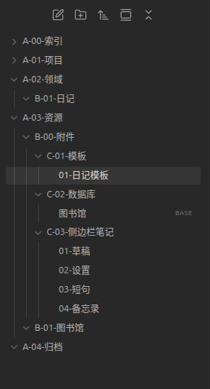
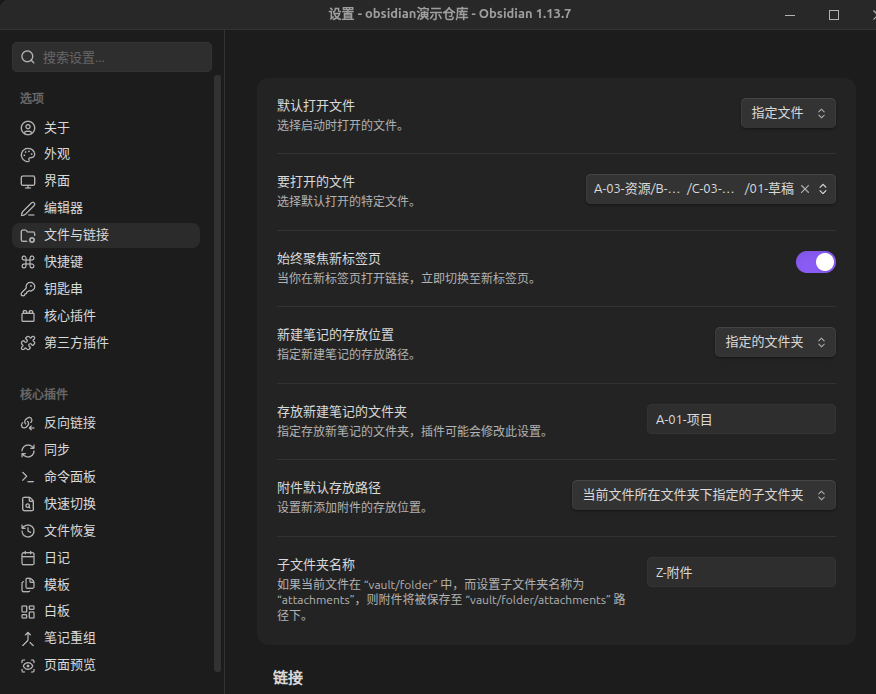
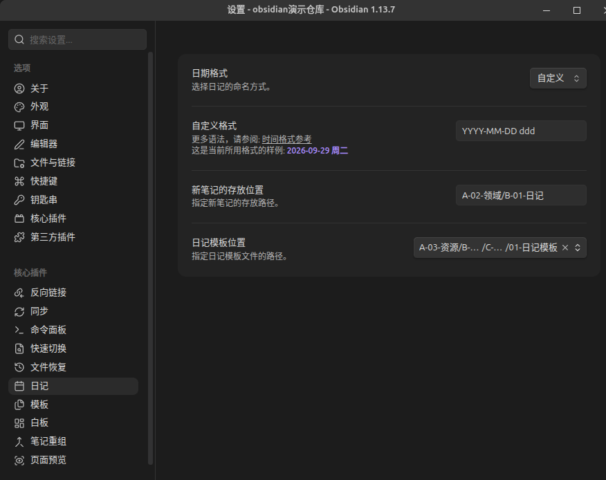
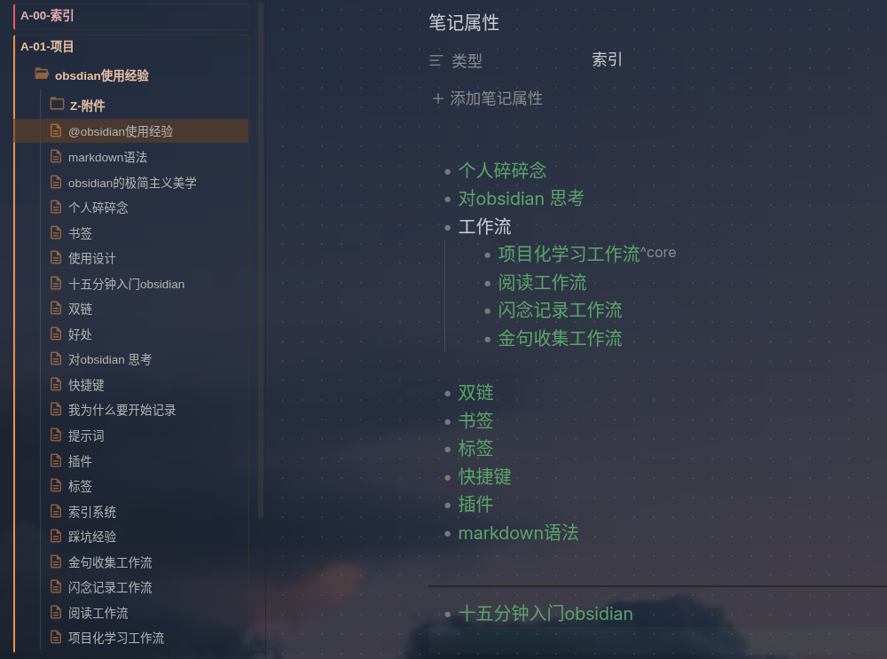

+++
date = '2026-11-05T22:16:16+08:00'
draft = false
title = '十五分钟快速上手obsidian'
type = "post"
categories = ["杂谈"]
image = "cover.jpg"
description = "面向新手，不搞插件，适用于初期不擅长管理和深度加工知识时，用一套通用的笔记管理系统避免信息无序堆积。(基于本人长期摆烂堆叠文件，突发恶疾式整理，未遂，后多次删库，而今悔不当初的血泪之谈)"
+++

# 文件夹结构

- 思路
	- 编码：（字母-01~99-笔记名）字母代表文件夹层级，数字用于文件排序。这套标准相当死板，所以搭起骨架后日常笔记并不需要刻意编码，而是通过双链建立中心化入口的，以下会介绍项目文件夹结构。
	- PARA法
		- P——project项目文件夹
			- 有明确目标，可完成的笔记
		- A——areas领域文件夹
			- 长期维持的项目，如日记、博客、语言学习等等
		- R——resources资源文件夹
			- 收集的有价值的电子资源，如电子书、网页或视频连接
		- A——archives归档文件夹
			- 完成的项目、暂停的领域
		- 索引文件夹——笔记的中心化入口，用于查找笔记
	- 侧边栏笔记——拖动到右侧边栏便于查看
		- 草稿：临时记录成形的想法，若是寻找灵感建议记日记
		- 设置：记录实际使用到的快捷键、文件属性，标签，工作流等等便于统一笔记形式
		- 短句：记录金句、诗词等等
		- 备忘录：我会记录细碎但不太重要的账号和密码
		- 任务列表：记录目标，截止日期等等，足以应对初级的任务管理

# 文件设置

- 默认打开文件：01-草稿（便于随手记录碎片信息，方便后期整理）（个人不选择日记，因为我不是天天写日记）
- 新建笔记放入A-01-项目（个人习惯，使得PARA文件夹目录保持整洁）
- 附件放在子文件夹，跟随项目移动。

# 日记设置

- 模板根据个人情况更改“01-日记模板”，建议添加（属性|日记）

# 项目文件夹结构

- 以下是我实际使用的展示，仅展示思路
	- 索引——@（项目名称）eg：@obsidian使用经验，即是右边笔记内容，通过双链形式做成项目笔记的中心化入口，其余项目笔记只需要放在该项目文件夹中。
	- 附件——存储笔记中的图片，若有强相关的电子资料书资源（例如《第二大脑》）我也会放里面
	

# Markdown语法精简
添加笔记属性：笔记开头三个短横线---（注：必须单独在笔记第一行）

N个#加空格代表N级标题

**加粗**：两个星号\*\*包裹

*斜体*：一个星号\*包裹

==画线==：两个\=\=包裹

~~删除线~~：两个波浪线

1. 有序列表:数字加点.加空格

- 无序列表：短横线\-加点.

	列表嵌套缩进TAB键，删除缩进SHIFT加TAB键

- 碎碎念：
	- 恭喜你已经初步入门了obsidian，这套PARA+编码系统足以应对前期笔记量较少的阶段，后续可以进行适当美化，跟随工作流的需要选用一些插件。不过，比起如何设置软件，我们更需要思考要记录什么？如果无从下手，大可以打开日记，简单记录当下正在发生什么，不必在意写下来的文字是否有价值，当你开始记录的时候，觉察的动作便会自然发生。

